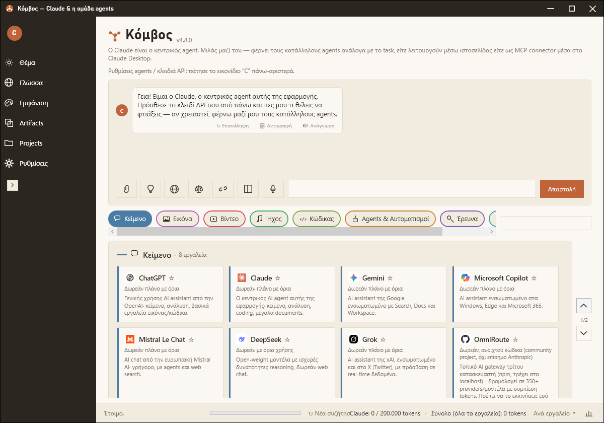
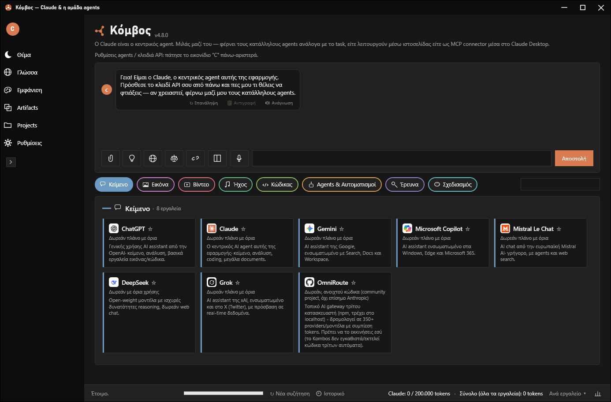
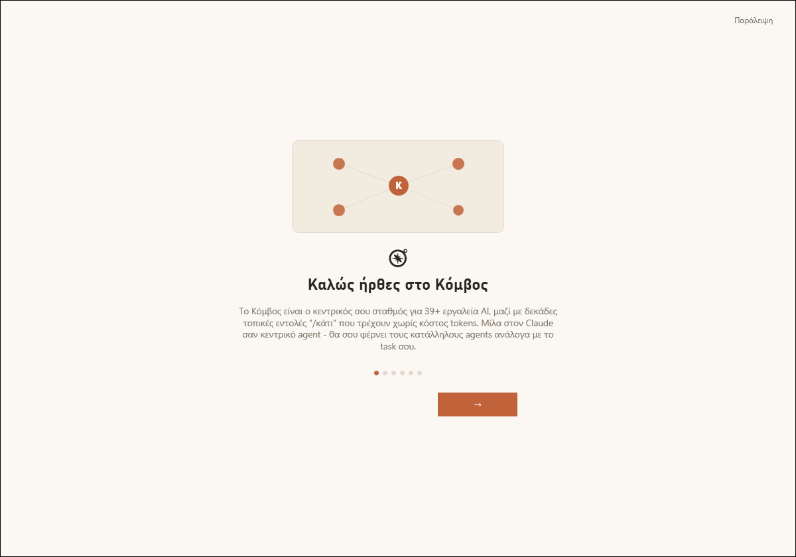
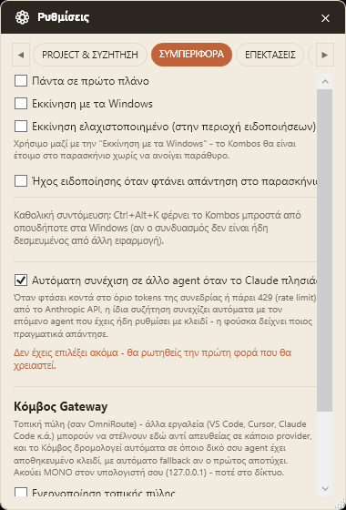
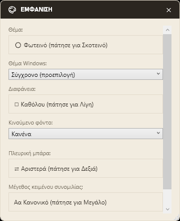

# Κόμβος (Kombos)

Ένας τοπικός κόμβος (hub) για εργαλεία τεχνητής νοημοσύνης στα Windows — στο κέντρο του βρίσκεται μια
συνομιλία με τον Claude (ή όποιον άλλο agent προτιμήσεις), που ξέρει τον κατάλογο 39+ εργαλείων AI και
σου φέρνει τα κατάλληλα ανάλογα με το task σου. Δωρεάν, ανοιχτού κώδικα, με τα κλειδιά API σου
κρυπτογραφημένα τοπικά και χωρίς καμία τηλεμετρία.

*A local Windows hub for AI tools, with Claude as the central agent that ties them together — see the [English section](#english) below.*

## Περιεχόμενα / Contents

- [Ελληνικά](#ελληνικά)
- [English](#english)
- [Άδεια / License](#άδεια--license)

## Ελληνικά

### Λειτουργίες

| Ενότητα | Τι κάνει |
|---|---|
| 💬 Συνομιλία & agents | Πραγματική σύνδεση με το Anthropic Messages API (Claude), ή οποιονδήποτε agent του καταλόγου με OpenAI-compatible endpoint (ChatGPT, Mistral, DeepSeek, Grok, Gemini) ως κεντρικό agent· ορατό extended thinking, αναζήτηση στο διαδίκτυο, επισύναψη εικόνων/αρχείων, απομακρυσμένοι MCP servers, prompt caching |
| ⚖ Σύγκριση & Handoff | Το ίδιο ερώτημα σε όλους τους agents ταυτόχρονα· pipeline όπου ένας agent γράφει πρόχειρο και ένας δεύτερος το βελτιώνει· διακλάδωση (Fork) συζήτησης από οποιοδήποτε μήνυμα |
| 🧰 Κατάλογος εργαλείων | 39+ εργαλεία σε 8 κατηγορίες (Κείμενο, Εικόνα, Βίντεο, Ήχος, Κώδικας, Agents & Αυτοματισμοί, Έρευνα, Σχεδιασμός) με λογότυπα, περιγραφές, καρφίτσωμα αγαπημένων, αναζήτηση σε όλες τις κατηγορίες και σύνδεσμο "Πρόσθεσε στο Claude Desktop (MCP)" |
| 🧠 Μνήμη & Projects | Projects με ομαδοποίηση συζητήσεων, Project Memory (ευρετήριο αρχείων + `/readfile`, `/verify`, `/search`), Hive Memory (ό,τι μαθαίνει ένας agent το ξέρουν όλοι), Presets/Personas, Βιβλιοθήκη Prompts, Shared Projects μέσω φακέλου συγχρονισμού |
| 🔌 Plugins | Σύστημα plugins με `AssemblyLoadContext` isolation, γκαλερί "Λήψη & Ενσωμάτωση", Plugin SDK με οδηγό "Νέο Plugin", Nexus Marketplace (από φάκελο ή Git URL) και 5 επίσημα πακέτα (Dev / Office / Business / Creative Toolkit, Weather) με εντολές `/κάτι` που τρέχουν τοπικά με μηδενικό κόστος tokens |
| 🌐 Kombos Gateway | Τοπική πύλη (`http://127.0.0.1:PORT/v1/chat/completions`, OpenAI-compatible) για VS Code, Cursor, Claude Code κ.ά., με αυτόματο fallback στον επόμενο ρυθμισμένο agent όταν ο πρώτος αποτύχει· ακούει ΜΟΝΟ στο 127.0.0.1 |
| 🔁 Αυτόματη συνέχιση | Όταν ο Claude πλησιάζει το όριό του, η συζήτηση συνεχίζει σε άλλον agent που έχεις ήδη ρυθμίσει — η φούσκα δείχνει πάντα ποιος απάντησε |
| ⚡ Kombos Anywhere | Ctrl+Alt+Space ανοίγει μικρή μπάρα quick-capture από οπουδήποτε στα Windows· Ctrl+Alt+K φέρνει το κύριο παράθυρο· Ctrl+K παλέτα εντολών |
| 🎤 Φωνή | Ανάγνωση απαντήσεων (τοπικό text-to-speech) και φωνητική εισαγωγή push-to-talk — χωρίς cloud |
| 🖼 Εικόνες & Artifacts | `/image` (δημιουργία εικόνας μέσα στη συζήτηση), Artifacts panel με όλα τα code blocks, ζωντανή προεπισκόπηση HTML/SVG/Markdown |
| 👥 Συνεργασία & δεδομένα | Συγχρονισμός συζητήσεων μέσω κοινού φακέλου (OneDrive/Dropbox/δίκτυο) σε πραγματικό χρόνο, συζήτηση σε ξεχωριστό παράθυρο, εισαγωγή από ChatGPT/Claude.ai (`conversations.json`), εξαγωγή/εισαγωγή JSON, τοπικό dashboard χρήσης tokens |
| 🎨 Εμφάνιση | Φωτεινό / Σκούρο / Σύστημα (ουδέτερο charcoal), 7 skins (Modern, Windows Vista/7/8/10-11, Classic, Nexus), 10 κινούμενα φόντα, ρυθμιζόμενη διαφάνεια, προσβάσιμο μέγεθος κειμένου, πτυσσόμενη πλευρική μπάρα, Focus mode (F11) |
| 🔒 Ασφάλεια | Κλειδιά API κρυπτογραφημένα με Windows DPAPI (δεμένα στον λογαριασμό χρήστη)· χειροκίνητος έλεγχος ενημερώσεων, ποτέ αθόρυβη λήψη/εγκατάσταση· καμία τηλεμετρία |

Επίσης: πλήρης μετάφραση σε 4 γλώσσες (Ελληνικά, English, Français, Deutsch), οδηγός πρώτης εκκίνησης,
tray icon με λειτουργία στο παρασκήνιο, και αυτόματα tests (DPAPI, αποθήκευση ρυθμίσεων/συζητήσεων, Gateway).

### Στιγμιότυπα οθόνης / Screenshots

<table>
<tr>
<td><br/><sub>Κύρια οθόνη, φωτεινό θέμα / Main window, light</sub></td>
<td><br/><sub>Κύρια οθόνη, σκούρο θέμα / Main window, dark</sub></td>
</tr>
<tr>
<td><br/><sub>Οδηγός πρώτης εκκίνησης / First-run guide</sub></td>
<td> <br/><sub>Ρυθμίσεις (Gateway, αυτόματη συνέχιση) και Εμφάνιση / Settings and Appearance</sub></td>
</tr>
</table>

### Εγκατάσταση

Κατεβάστε το τελευταίο `KombosSetup-*.exe` από τα [Releases](../../releases) και εκτελέστε το. Δεν απαιτεί
δικαιώματα διαχειριστή· προσφέρει προαιρετική συντόμευση επιφάνειας εργασίας και εκκίνηση με τα Windows.
Χρειάζεται το [.NET 10 Desktop Runtime](https://dotnet.microsoft.com/download/dotnet/10.0). Χρειάζεσαι δικό σου
κλειδί API (π.χ. από [console.anthropic.com](https://console.anthropic.com)) — μπαίνει στις Ρυθμίσεις → Agent,
κρυπτογραφημένο τοπικά, ποτέ σε καθαρό κείμενο.

### Χτίσιμο από τον πηγαίο κώδικα

```
dotnet build
dotnet run
```

Το εκτελέσιμο βγαίνει στο `bin/Debug/net10.0-windows/Kombos.exe`. Για installer:

```
dotnet publish Kombos.csproj -c Release -r win-x64 --self-contained false -o publish
ISCC.exe installer/Kombos.iss
```

Το τελικό `KombosSetup-<έκδοση>.exe` καταλήγει στο `installer/output/`. Tests: `dotnet test Kombos.Tests`.

### Δομή αποθετηρίου

```
Kombos.csproj                   Κύριο project (.NET 10, WPF + WinForms για το tray icon)
MainWindow.xaml(.cs)            UI + κύρια λογική chat/κατάλογος
SettingsWindow / AgentSettingsWindow / AppearanceWindow   Ρυθμίσεις, agents, εμφάνιση
Themes/                         Light / Dark / Icons (vector εικονίδια)
Models/, Data/Catalog.cs        Μοντέλα δεδομένων και ο κατάλογος εργαλείων
Services/                       ClaudeClient, OpenAiCompatibleClient, GatewayServer, SettingsStore,
                                ConversationStore, DpapiProtector, PluginLoader, UpdateChecker, ...
Localization/L.cs               Όλα τα strings σε 4 γλώσσες + Ιστορικό εκδόσεων
Plugins/IKombosPlugin.cs        Contract για plugins τρίτων
plugins-src/                    Πηγαίος κώδικας των επίσημων plugins (ξεχωριστά .csproj)
Kombos.Tests/                   Unit tests (xUnit)
installer/                      Script εγκατάστασης (Inno Setup)
```

Plugins τρίτων: βάλε τον φάκελο του plugin (με το .dll του) στο `%AppData%\Kombos\plugins\` και κάνε
επανεκκίνηση· δες το `plugins-src/KombosWeather` για πλήρες παράδειγμα. Το πλήρες ιστορικό αλλαγών
είναι στο [CHANGELOG.md](CHANGELOG.md).

## English

A local Windows hub for AI tools. At its center is a chat with Claude (or any other agent you prefer)
that knows a catalog of 39+ AI tools and brings in the right ones for your task. Free, open source,
with your API keys encrypted locally and no telemetry whatsoever.

### Features

| Area | What it does |
|---|---|
| 💬 Chat & agents | Real Anthropic Messages API integration (Claude), or any catalog agent with an OpenAI-compatible endpoint (ChatGPT, Mistral, DeepSeek, Grok, Gemini) as the central agent; visible extended thinking, web search, image/file attachments, remote MCP servers, prompt caching |
| ⚖ Compare & Handoff | Send one question to every agent at once; a pipeline where one agent drafts and a second refines; fork a conversation from any message |
| 🧰 Tool catalog | 39+ tools in 8 categories (Text, Image, Video, Audio, Code, Agents & Automation, Research, Design) with logos, descriptions, pinned favorites, cross-category search and an "Add to Claude Desktop (MCP)" link |
| 🧠 Memory & Projects | Projects grouping conversations, Project Memory (file index + `/readfile`, `/verify`, `/search`), Hive Memory (what one agent learns, all agents know), Presets/Personas, Prompt Library, Shared Projects via a sync folder |
| 🔌 Plugins | Plugin system with `AssemblyLoadContext` isolation, a "Download & Install" gallery, a Plugin SDK with a "New Plugin" wizard, Nexus Marketplace (from a folder or Git URL) and 5 official packs (Dev / Office / Business / Creative Toolkit, Weather) with `/something` commands that run locally at zero token cost |
| 🌐 Kombos Gateway | A local OpenAI-compatible gateway (`http://127.0.0.1:PORT/v1/chat/completions`) for VS Code, Cursor, Claude Code etc., with automatic fallback to the next configured agent when the first fails; listens on 127.0.0.1 ONLY |
| 🔁 Automatic continuation | When Claude nears its limit, the conversation continues on another agent you already configured — the reply bubble always shows who answered |
| ⚡ Kombos Anywhere | Ctrl+Alt+Space opens a mini quick-capture bar from anywhere in Windows; Ctrl+Alt+K summons the main window; Ctrl+K is the command palette |
| 🎤 Voice | Read-aloud (local text-to-speech) and push-to-talk voice input — no cloud |
| 🖼 Images & Artifacts | `/image` (generate an image inside the conversation), an Artifacts panel with every code block, live HTML/SVG/Markdown preview |
| 👥 Collaboration & data | Real-time conversation sync through a shared folder (OneDrive/Dropbox/network), detach a conversation into its own window, import from ChatGPT/Claude.ai (`conversations.json`), JSON export/import, local token-usage dashboard |
| 🎨 Appearance | Light / Dark / System (neutral charcoal), 7 skins (Modern, Windows Vista/7/8/10-11, Classic, Nexus), 10 animated backgrounds, adjustable transparency, accessible text size, collapsible sidebar, Focus mode (F11) |
| 🔒 Security | API keys encrypted with Windows DPAPI (tied to your Windows account); manual update check, never a silent download/install; no telemetry |

Also: full translation in 4 languages (Greek, English, French, German), a first-run guide, a system-tray
icon with background operation, and automated tests (DPAPI, settings/conversation storage, Gateway).

### Screenshots

See the [screenshot gallery](#στιγμιότυπα-οθόνης--screenshots) above.

### Installation

Download the latest `KombosSetup-*.exe` from [Releases](../../releases) and run it. It needs no
administrator rights and offers an optional desktop shortcut and start-with-Windows. Requires the
[.NET 10 Desktop Runtime](https://dotnet.microsoft.com/download/dotnet/10.0). You need your own API key
(e.g. from [console.anthropic.com](https://console.anthropic.com)) — it goes into Settings → Agent,
encrypted locally, never stored in plain text.

### Building from source

```
dotnet build
dotnet run
```

The executable lands in `bin/Debug/net10.0-windows/Kombos.exe`. For the installer:

```
dotnet publish Kombos.csproj -c Release -r win-x64 --self-contained false -o publish
ISCC.exe installer/Kombos.iss
```

The final `KombosSetup-<version>.exe` lands in `installer/output/`. Tests: `dotnet test Kombos.Tests`.

### Repository layout

See the Greek section above for the annotated tree. Third-party plugins: drop the plugin folder (with
its .dll) into `%AppData%\Kombos\plugins\` and restart; see `plugins-src/KombosWeather` for a complete
example. The full change history is in [CHANGELOG.md](CHANGELOG.md).

## Άδεια / License

Τα κλειδιά API που εισάγεις χρησιμοποιούνται με δική σου ευθύνη· κάθε χρέωση γίνεται στον δικό σου
λογαριασμό στον αντίστοιχο πάροχο. Τα εργαλεία/agents τρίτων που εμφανίζονται στον κατάλογο δεν ανήκουν
ούτε ελέγχονται από αυτή την εφαρμογή. Το Kombos Gateway είναι εμπνευσμένο από την ιδέα του ανοιχτού
κώδικα [OmniRoute](https://github.com/diegosouzapw/OmniRoute) (MIT)· δεν αντιγράφηκε κώδικας.

*API keys you enter are used at your own risk; any charges go to your own account with the respective
provider. Third-party tools/agents shown in the catalog are neither owned nor controlled by this
application. Kombos Gateway is inspired by the idea behind the open-source
[OmniRoute](https://github.com/diegosouzapw/OmniRoute) (MIT); no code was copied.*

**Το λογισμικό παρέχεται "ΩΣ ΕΧΕΙ", χωρίς καμία εγγύηση. / Provided "AS IS", without warranty of any kind.**
